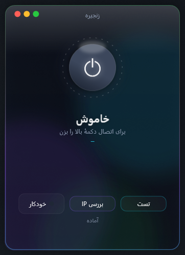

<div align="center">

# Zanjir

**زنجیره — ویندسکرایب روی سرور شخصی شما**

اگر اتصال مستقیم به سرورهای ویندسکرایب در شبکهٔ شما مسدود یا ناپایدار است،
Zanjir ترافیک ویندسکرایب را از سرور شخصی خودتان عبور می‌دهد تا بدون افت وصل شوید.

`s e p e h r s d q`



</div>

---

## این برنامه چه می‌کند؟

مسیر نهایی اتصال شما این‌شکلی است:

```
برنامه‌های ویندوز  ←  تونل ویندسکرایب  ←  سرور شخصی شما (VLESS)  ←  اینترنت
```

برنامه با sing-box یک تانل سبک می‌سازد که فقط IPهای سرورهای ویندسکرایب را از
سرور شخصی شما عبور می‌دهد؛ بقیهٔ ترافیک سیستم دست‌نخورده می‌ماند. سپس در اپ
ویندسکرایب با پروتکل Stealth وصل می‌شوید و تانل ویندسکرایب روی زنجیرهٔ شما
سوار می‌شود — بدون تداخل با روتینگ ویندوز.

## ویژگی‌ها

- رابط شیشه‌ای مینیمال به سبک macOS با انیمیشن
- دکمهٔ پاور مرکزی: یک کلیک اتصال، یک کلیک قطع
- پنل ترافیک زنده (نمایش مسیر هر اتصال: «سرور من» یا «مستقیم»)
- تست پینگ مسیر و بررسی IP
- گزینهٔ اجرای خودکار با ورود ویندوز
- فایل اجرایی سبک (~۴۰KB) بدون نیاز به نصب هیچ‌چیز

## پیش‌نیازها

- ویندوز ۱۰ یا ۱۱
- [sing-box نسخهٔ 1.14.4](https://github.com/SagerNet/sing-box/releases) برای ویندوز amd64
- یک سرور شخصی با کانفیگ VLESS (Reality یا WebSocket+TLS)
- اکانت ویندسکرایب

## نصب

۱. پوشهٔ `bin/sing-box-1.14.4-windows-amd64` را کنار برنامه بسازید و فایل
   `sing-box.exe` را از ریلیز رسمی sing-box داخلش بگذارید:

```
Zanjir/
├── WindscribeChainMini.exe
├── config.json
└── bin/
    └── sing-box-1.14.4-windows-amd64/
        └── sing-box.exe
```

۲. فایل `config.example.json` را به `config.json` تغییر نام دهید و فقط این
   فیلدها را با کانفیگ سرور خودتان پر کنید:

| فیلد | توضیح |
|---|---|
| `YOUR_VPS_IP` | آی‌پی سرور شخصی شما |
| `YOUR_UUID_1` | UUID کانفیگ Reality |
| `YOUR_UUID_2` | UUID کانفیگ WebSocket (اگر ندارید همان UUID اول) |
| `YOUR_REALITY_PUBLIC_KEY` | کلید عمومی Reality |
| `YOUR_SHORT_ID` | shortId مربوطه |
| `YOUR_CDN_DOMAIN` | دامنهٔ پشت CDN (اختیاری) |
| `YOUR_WS_PATH` | مسیر WebSocket (اختیاری) |

۳. `START.bat` را اجرا کنید (درخواست دسترسی ادمین برای ساخت تانل را تأیید کنید).

۴. در برنامهٔ Zanjir دکمهٔ پاور را بزنید تا «روشن» شود.

۵. در اپ ویندسکرایب: **Settings ← Connection ← Protocol ← Stealth** و بعد سرور
   دلخواه را انتخاب و Connect بزنید.

> نکتهٔ مهم: حتماً از پروتکل **Stealth** استفاده کنید. WireGuard و IKEv2 سوکت
> خود را مستقیم به کارت شبکه قفل می‌کنند و وارد زنجیره نمی‌شوند.

## ساخت از سورس

فقط `build.bat` را اجرا کنید — با کامپایلر داخلی ویندوز (csc) ساخته می‌شود و
هیچ ابزار اضافه‌ای لازم نیست:

```
build.bat   →   WindscribeChainMini.exe
```

## رفع اشکال

- **خطای «اداپتر مانده بود»**: برنامه خودش یک بار دیگر تلاش می‌کند؛ اگر نشد چند
  ثانیه صبر کنید و دوباره دکمهٔ پاور را بزنید.
- **وصل شد ولی IP تغییر نکرد**: در پنل ترافیک باید سطر `windscribewstunnel.exe`
  با برچسب «سرور من» دیده شود؛ اگر «مستقیم» است، اتصال ویندسکرایب را قطع و وصل
  کنید.
- **سرور خاصی وصل نشد**: آن سرور شاید در فهرست رنج‌های برنامه نباشد — در
  `config.json` آی‌پی آن سرور را به `route_address` اضافه کنید.

## لایسنس

MIT — استفاده، تغییر و توزیع آزاد است.
